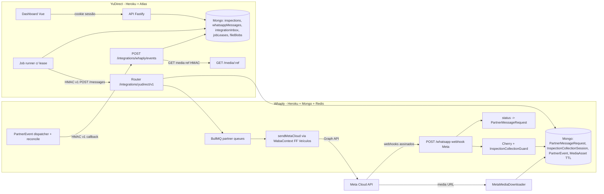

# Plano técnico: vistoria por WhatsApp com YuDirect, Whaply e WhatsApp Cloud API

> Este documento é a cópia versionada do plano aprovado. O status de implementação de cada fase está em §17.
> Ao executar a Fase 0, este arquivo é copiado para `frotaone/docs/architecture/yudirect-whaply-vistoria-plan.md`, que é o destino pedido.
> Legenda das evidências, no padrão do `docs/ASSUMPTIONS.md` do YuDirect: **[O]** observado no código ou no documento, **[I]** inferido, **[R]** recomendação, **[P]** pendente ou lacuna.
> Caminhos marcados `Y:` são relativos a `D:\Projects\Younix\frotaone`. Caminhos marcados `W:` são relativos a `D:\Projects\Oficial\Whaply`.

---

## 0. Resumo executivo

**Contexto.** O YuDirect já cria vistorias com data (`scheduledAt`) e um link público onde o motorista envia fotos (`/vistoria/:token`). O envio por WhatsApp, porém, é um `fetch` genérico sem provedor real: não recebe status nem respostas, e por isso hoje sempre cai no link `wa.me` manual [O]. O Whaply já fala com a WhatsApp Cloud API da Meta, e a FF Veículos já está cadastrada nele como `Company` com a vertical `VEHICLE_RENTAL` [O]. O objetivo é que, no dia agendado, o cliente receba a solicitação pelo WhatsApp, envie as fotos por lá e o responsável aprove ou reprove a vistoria no YuDirect, com rastreabilidade de ponta a ponta.

**Decisões confirmadas com o usuário:**
1. **Coleta guiada.** O Whaply pede um ângulo por vez, e a foto recebida é associada ao ângulo pedido naquele momento. O link web continua como alternativa.
2. **Aprovação.** Continua valendo a permissão que já existe (`inspections:review`, concedida a OWNER, ADMIN ou MEMBER autorizado), com auditoria obrigatória.
3. **Opt-in.** Um campo de consentimento no cadastro do motorista, com data, origem e quem registrou. Sem consentimento, o envio é bloqueado.
4. **Horário de disparo.** Um horário padrão configurável na organização (por exemplo 09:00 em America/Sao_Paulo).

**Arquitetura recomendada [R]:**
- Os dois sistemas conversam por HTTPS com requisições assinadas por HMAC (timestamp, nonce e hash do corpo), uma chave por direção.
- **YuDirect → Whaply:** comandos idempotentes, gravados antes numa caixa de saída (outbox) persistida no Mongo.
- **Whaply → YuDirect:** eventos assinados, também gravados numa outbox persistida, com reenvio e número de sequência. As fotos são baixadas pelo YuDirect a partir de uma referência temporária.
- **Sem infraestrutura nova.** Nada de broker nem de microserviço. Usamos o Mongo dos dois lados, mais o BullMQ e o Redis que o Whaply já tem.
- **Tokens da Meta.** Só o Whaply tem os tokens. O YuDirect nunca os vê.

**O que muda de verdade:**
- **No Whaply:**
  - Uma API de parceiro, que hoje não existe.
  - O download de mídia recebida, que não existe.
  - Uma sessão de coleta com roteamento prioritário, porque hoje nada lê `context.id`.
  - Uma outbox de eventos, que não existe.
- **No YuDirect:**
  - Um adaptador do Whaply no lugar do envio genérico.
  - O registro de consentimento.
  - Um disparador agendado com trava de concorrência (lease).
  - O recebimento de eventos e das fotos.
  - Um dashboard de mensagens.
  - Correções de concorrência que já existem hoje.

**Principais riscos:**
- A Meta pode recategorizar os templates de UTILITY para MARKETING.
- Desde 01/10/2026 há cobrança também dentro da janela de 24h.
- Hoje o Whaply perde o wamid dos envios adiados.
- Foto ambígua (sem sessão ativa) nunca é associada automaticamente a uma vistoria.

---

## 1. Diagnóstico do cenário atual

### 1.1 YuDirect: o que já existe
| Tema | Fato | Fonte |
|---|---|---|
| Stack | Fastify 5, driver MongoDB (sem ORM), Zod em `packages/contracts`, Vue 3, Vite, Pinia. Deploy no Heroku com uma única dyno web, banco no Atlas (replica set) | `Y:apps/api/src/app.ts`, `Y:package.json` [O] |
| Vistoria | `InspectionDoc` com `scheduledAt`/`dueDate` (só data, sem hora), `status` (PENDING, SUBMITTED, APPROVED, REJECTED, CANCELED), `photos[{slotCode,slotLabel,fileId}]`, `delivery{channel,status,attempts}`, `requestTokenHash`, `source MANUAL/SCHEDULED`. Não tem `version` | `Y:apps/api/src/database/types.ts` [O] |
| Ângulos | `PhotoSlotDoc` (código, label, ordem, ativo). Todo ângulo ativo é obrigatório. Os 5 padrões estão em `DEFAULT_PHOTO_SLOTS` (Frente, Traseira, Lateral Esquerda, Lateral Direita, Painel/KM). Limite de 12 | `Y:packages/contracts/src/inspections.ts` [O] |
| Transições | Só nos handlers de `Y:apps/api/src/modules/inspections/routes.ts`: criação (PENDING), submit público (SUBMITTED), review (APPROVED ou REJECTED, com 409 fora de SUBMITTED) e DELETE (CANCELED) | [O] |
| Aprovação | `can()` em `Y:packages/contracts/src/permissions.ts`, com o módulo `inspections` e a ação `review`. A auditoria `audit()` está em `Y:apps/api/src/services/common.ts` (`inspection.approved` e `inspection.rejected`) | [O] |
| WhatsApp | `createIntegrations` em `Y:apps/api/src/integrations/index.ts`: POST genérico, `to` só com dígitos locais, HTTP 200 contado como "enviado", sem template, sem mídia e sem recebimento | [O] |
| Jobs | `Y:apps/api/src/jobs/scheduler.ts` usa `setInterval` (30 min) sem trava. A idempotência depende só de índices únicos (`dedupeKey`) | [O] |
| Arquivos | O driver `mongo` grava Base64 em `fileBlobs`, até 11 MB. `storeFile` verifica o tipo real pelos bytes (PNG, JPEG, WEBP). URLs assinadas com HMAC | `Y:apps/api/src/storage/index.ts`, `Y:apps/api/src/services/files.ts` [O] |
| Auth | Cookie de sessão. A checagem de CSRF por `Origin` deixa passar requisições sem `Origin`, o que vale para chamadas entre servidores. Há rate limit global | `Y:apps/api/src/app.ts`, `Y:apps/api/src/plugins/auth.ts` [O] |
| Testes | Vitest com `createHarness` (Mongo em memória, replica set) em `Y:apps/api/src/testing/harness.ts`. `flows.test.ts` organizado por IDs T01 a T21. E2E com Playwright em `Y:e2e/` | [O] |

**Lacunas no YuDirect [P]:**
- A recorrência `inspectionRule` existe, mas nada gera vistorias a partir dela.
- O motorista não tem campo de opt-in, e os telefones são gravados sem +55.
- O submit não valida se cada `fileId` pertence à organização e tem a finalidade `INSPECTION_PHOTO`.
- Submit e review fazem o update sem condicionar o status, então há corrida (dois pedidos simultâneos podem passar).
- REJECTED é estado final: não há como pedir correção.
- O scheduler não tem trava.
- Imagens HEIC não são aceitas.
- Não há testes de submit, review e cancel com sucesso.

### 1.2 Whaply: o que já existe
| Tema | Fato | Fonte |
|---|---|---|
| Stack | Express 5, mongoose 8, ioredis, BullMQ (11 workers dentro da dyno web), redlock, Datadog. Heroku com `web: npm start` | `W:src/app.ts`, `W:Procfile`, `W:.claude/CLAUDE.md` [O] |
| Tenant | `Company` → `WhatsappBusiness` (`phone_number_id` único, `waba_id`, token cifrado com RSA via `MajinBoo`) | `W:src/app/models/Company.ts`, `W:src/app/models/WhatsappBusiness.ts` [O] |
| FF Veículos | Encontrada pelo nome em `W:scripts/setup-ff-veiculos-guest.cjs`. Vertical `VEHICLE_RENTAL` em `W:src/app/domain/establishment/VehicleRental.ts`. Já tem os estados `VehicleMaintenance`/`VehicleFinancial` | [O] |
| Envio | `resolveWabaContext(companyId, phoneNumberId)` em `W:src/app/services/whatsapp/WabaContext.ts`. `WhatsappMessagingRequest.sendMetaCloud` nunca lança exceção e tem três resultados: `null` (adiado pela Chronos ou por 131056), resposta com wamid, ou objeto de erro | [O] |
| Templates | Espelho `WhatsappTemplate` (status e categoria), `TemplateManagementService.sync` e webhooks de status e de categoria (`applyWebhook`) | `W:src/app/models/WhatsappTemplate.ts`, `W:src/app/services/whatsapp/TemplateManagementService.ts` [O] |
| Padrão de envio durável | `BookingReminder`: id determinístico, `$setOnInsert`, claim atômico, `interpretSendResponse`, promoção só para a frente por wamid e reconcile a cada 5 min | `W:src/app/services/booking/BookingReminderEngine.ts`, `W:src/app/models/BookingReminder.ts`, `W:tests/integration/booking/BookingReminders.test.ts` [O] |
| Webhook da Meta | `GET/POST /whatsapp`: HMAC `x-hub-signature-256` sobre o corpo cru (`WhatsappSecurity.validateRequestSignature`), dedup Redis `webhook:msg:{wamid}` (deixa passar se o Redis cair), status gravados em `WhatsappMessageStatus` com o campo `pricing` | `W:src/app/routes/WhatsappRouter.ts`, `W:src/app/middleware/WhatsappSecurity.ts` [O] |
| Roteamento | `handlePayload` → EventBus → `Cherry.handleTurn`. Usa trava por telefone, `HumanTakeoverGuard`, `ButtonSecretGuard` (botões assinados) e `StateResolver`. **Não lê `context.id`** | `W:src/app/core/machine/Cherry.ts` [O] |
| Mídia | **Não baixa mídia recebida**: `WhatsappMedia.getMediaID` lança "not implemented". Já existem peças reaproveitáveis: `RemoteImageFetcher` (proteção SSRF e limite de tamanho), `ImageProcessor` (sharp) e `MediaAsset` (binário no Mongo) | `W:src/app/services/media/*` [O] |
| Janela 24h | Só a caixa de atendimento humano verifica a janela (`InboxService.isWindowOpen` com `Conversation.last_inbound_at`) | [O] |
| API de parceiro | **Não existe.** Todos os envios exigem sessão de painel. Os padrões de HMAC de entrada estão em iFood, Uber e MelhorEnvio | `W:src/app/modules/ifood/events/IFoodWebhook.ts`, `W:src/app/middleware/UberSecurity.ts` [O] |
| Convenções | Seguem `.claude/rules/whaply-rules.md`: router dedicado, orquestração em services, nunca afrouxar a assinatura de webhook, só enviar WhatsApp depois de confirmar a escrita no banco, idempotência, telefone com `hashPhone` nos spans. Commits em Conventional Commits em português | [O] |

**Riscos do Whaply que a integração não deve agravar [O]:**
- O `.env` está versionado no git.
- O token aparece descriptografado no job da `messageQueue`, guardado no Redis.
- `AxiosEyes` usa `APP_SECRET_TOKEN` como token de reserva.
- `TemplateService.sendTemplateMessage` ignora a resposta da Meta e envia mesmo sem o template no espelho local.
- Um envio adiado (`null`) perde o wamid.
- Os registros de `WhatsappMessageStatus` não são deduplicados.
- A Chronos e a dedup deixam passar quando o Redis falha.

### 1.3 Regras da Meta: fontes verificadas em 10/11/2026
| Fato | Fonte |
|---|---|
| Cobrança por mensagem **entregue**, desde 01/07/2025 | developers.facebook.com/documentation/business-messaging/whatsapp/pricing (atualizada até 01/10/2026) |
| **A partir de 01/10/2026** há cobrança de serviço além de uma franquia de **1.000 mensagens de serviço por mês por número**, e de **utilidade dentro da janela de 24h** (que era grátis) | mesma fonte; cópia interna em `W:docs/meta/docs/whatsapp/prices/prices.md` |
| Conversa iniciada pela empresa exige template aprovado. Fora da janela de 24h, só template | whatsappbusiness.com/policy (atualizada em 23/09/2026) |
| A janela abre e é renovada a cada mensagem ou ligação do usuário, por 24h | página de pricing |
| Opt-in obrigatório. É preciso respeitar opt-out e bloqueio | policy |
| Utility precisa ser "específica ou solicitada pelo usuário" e não promocional. Conteúdo misto vira MARKETING. Há recategorização automática (webhook `template_category_update`) | developers.facebook.com/documentation/business-messaging/whatsapp/templates/template-categorization |
| Faturamento em **BRL** para empresas brasileiras desde 01/07/2026, com migração obrigatória até 30/06/2027 | página de pricing |
| Limites por **portfólio** (desde 07/10/2025): 250, 2.000, 10.000, 100.000 e ilimitado, contados em usuários únicos por 24h fora da janela | developers.facebook.com/documentation/business-messaging/whatsapp/messaging-limits |

**Divergências [P]:**
- `W:docs/WhatsApp_Business_Messaging_Guia_Mestre.md`, de abril de 2026, diz que utility dentro da janela é grátis. Isso **está desatualizado** desde 01/10/2026.
- O mesmo guia cita o nível "1K". O nível correto é **2.000**.
- A página em português diz que a janela gratuita de entrada (FEP) dura 72h, e a em inglês diz até 7 dias. Isso não afeta este fluxo, que não vem de anúncio.
- **Não conseguimos confirmar as tarifas por categoria para o Brasil.** As tabelas são arquivos que a página não expõe. A única referência interna é "0,68 ¢ USD" para utility e authentication, em `prices.md`. O painel de custos vai usar uma tabela de tarifas cadastrada manualmente, com a fonte e a data.
- **Classificação provável:** a solicitação de fotos de uma vistoria do veículo alugado pelo próprio usuário deve ser **UTILITY**, porque é um serviço específico do contrato dele [I]. A Meta pode recategorizar; o plano trata essa hipótese.

---

## 2. Arquitetura proposta

### 2.1 Alternativas avaliadas
| Alternativa | Veredito |
|---|---|
| API interna síncrona, sem persistência | ❌ Perde intenções se houver timeout ou reinício e não dá rastreabilidade |
| **API autenticada e assíncrona + callbacks assinados + outbox/inbox no Mongo dos dois lados** | ✅ **Escolhida.** Usa só o que já existe (Mongo nos dois sistemas, BullMQ e Redis no Whaply), é durável, entrega pelo menos uma vez e o efeito final é idempotente |
| Broker (Kafka, SQS) | ❌ O Whaply tem Kafka só para a Payprice. Para dois serviços com volume baixo (dezenas de vistorias por semana), seria mais infraestrutura e mais pontos de falha |
| Polling puro | ❌ Daria latência alta nas fotos. Fica apenas como **reconciliação** (`GET /events?afterSeq=`) |
| YuDirect falando direto com a Meta | ❌ Duplicaria tokens, templates e o webhook, o que viola as restrições |

### 2.2 Diagrama


### 2.3 Responsabilidades
- **YuDirect.** Dono do estado oficial da vistoria. Decide quando disparar e quais ângulos pedir. Guarda o histórico de mensagens para a operação, o consentimento, a aprovação e a auditoria.
- **Whaply.** Dono do canal com a Meta. Fixa a conta da FF Veículos e escolhe template ou mensagem livre conforme a janela. Conduz a conversa guiada, recebe o webhook e baixa a mídia. Publica eventos ao YuDirect.

---

## 3. Fluxo completo (sequência)

```mermaid
sequenceDiagram
  autonumber
  participant J as YuDirect Job
  participant Y as YuDirect API
  participant W as Whaply API
  participant M as Meta
  participant C as Cliente
  participant O as Responsável
  J->>Y: scheduledSendAt <= agora (lease)
  Y->>Y: cria intent (idempotencyKey único) status=INTENT_CREATED
  J->>W: POST /v1/messages (HMAC, Idempotency-Key)
  alt timeout/5xx
    J->>W: retry mesma chave (backoff+jitter) -> 200 mesmo requestId
  end
  W-->>J: 202 requestId (ACCEPTED_BY_WHAPLY)
  W->>W: claim, valida template APPROVED, consentimento, conta fixa
  W->>M: template yudirect_vistoria_solicitacao
  M-->>W: wamid
  W->>Y: event message.accepted (wamid)
  M-->>W: status sent/delivered/read (+pricing)
  W->>Y: events message.sent/delivered/read
  C->>M: toca "Iniciar vistoria" (abre janela 24h)
  M->>W: webhook button (payload assinado = sessão)
  W->>C: "Envie a FRENTE (1/5)"
  C->>M: imagem
  M->>W: webhook image (media_id)
  W->>M: GET media -> download (allowlist, limite)
  W->>W: MediaAsset TTL 7d, sha256, step=FRONT
  W->>Y: event session.media_received {slotCode, mediaRef, sha256}
  Y->>W: GET /v1/media/:ref (HMAC)
  Y->>Y: storeFile INSPECTION_PHOTO, evidência slot FRONT
  W->>C: "Recebida ✅ Agora a TRASEIRA (2/5)"
  Note over W,C: ... repete; KM pedido como texto após PAINEL
  W->>Y: event session.completed
  Y->>Y: collection=COMPLETE, inspection PENDING->SUBMITTED (aguardando revisão)
  O->>Y: revisa fotos, aprova / reprova / pede correção (auditoria)
  opt correção
    Y->>W: POST /v1/messages kind=CORRECTION (slots X,Y)
  end
```

**Caminhos de erro:**
- **Template não aprovado:** o Whaply responde `422 TEMPLATE_NOT_APPROVED`. O YuDirect marca a mensagem como `FAILED` sem nova tentativa, oferece o link manual e cria um alerta.
- **Cliente sem opt-in:** o YuDirect nem cria a intenção. A vistoria fica `collection=BLOCKED_NO_CONSENT`.
- **Meta indisponível:** o Whaply tenta de novo com backoff. Erros permanentes (`PERMANENT_META_CODES`) viram `FAILED`.
- **Whaply indisponível:** a outbox do YuDirect tenta de novo e o reconciliador cobre o restante.
- **YuDirect indisponível:** a outbox de eventos do Whaply tenta de novo por até 72h e depois marca `DEAD` e alerta. O YuDirect recupera os eventos com `GET /events?afterSeq`.
- **Webhook duplicado ou fora de ordem:** o status só avança para a frente e a dedup é por `eventId` e por `wamid+status`.
- **Foto sem sessão ativa:** segue o fluxo normal do Whaply e não é associada a nenhuma vistoria (ver §5.4).

---

## 4. Modelo de dados

### 4.1 YuDirect (Mongo, sem migração destrutiva; os campos novos são opcionais)
- **`drivers.whatsappConsent`**:
  - Campos: `{status: GRANTED|REVOKED, grantedAt, source: CONTRACT|IN_PERSON|WHATSAPP|OTHER, recordedBy, revokedAt?, revokedSource?: OPERATOR|WHATSAPP_STOP}`.
  - Também guarda o histórico em `auditLogs` (`driver.consent_granted` e `driver.consent_revoked`).
  - Novo helper `toE164BR(localDigits)` em `Y:packages/contracts/src/common.ts`, que gera `+55DDDNÚMERO`.
- **`organizations.settings.inspectionWhatsapp`**: `{enabled, sendTime:'HH:mm', reminderAfterHours (padrão 24), maxReminders (padrão 1), collectionTtlHours (padrão 72)}`.
- **`inspectionPhotoSlots.instruction?`**: texto curto que a coleta guiada envia para cada ângulo.
- **`inspections`** (campos novos):
  - `version`, para concorrência otimista.
  - `scheduledSendAt: Date`, calculado a partir de `scheduledAt` e de `sendTime` no fuso America/Sao_Paulo.
  - `collection`:
    - Campos: `{mode: WHATSAPP|WEB_LINK|MANUAL, status: NOT_SCHEDULED|SCHEDULED|BLOCKED_NO_CONSENT|REQUESTED|IN_PROGRESS|PARTIAL|COMPLETE|EXPIRED|FAILED|CANCELED, requiredSlots:[{code,label,order}] (snapshot), receivedSlots:[code], odometerSource, sessionRef, correlationId}`.
    - `photoEvidence[]`, só acrescentado e nunca sobrescrito: `{slotCode, fileId, source: WHATSAPP|WEB|OPERATOR, receivedAt, externalMediaId, sha256, wamid, round, supersededAt?}`.
    - `photos[]` passa a ser a visão atual derivada de `photoEvidence`. Mantém o mesmo formato, para não quebrar a interface.
  - `correctionRound` (começa em 0) e `correctionRequests[]` `{slots, reason, requestedBy, at}`.
- **`whatsappMessages`** (coleção nova; serve de outbox e de histórico):
  - Campos: `{organizationId, inspectionId, driverId, kind: INSPECTION_REQUEST|REMINDER|CORRECTION, idempotencyKey, correlationId, templateName, category, status, whaplyRequestId, wamid, attempts, nextAttemptAt, leaseUntil, lastError{code,message,source: YUDIRECT|TRANSPORT|WHAPLY|META}, pricing{billable,category,type}, timestamps{intentAt,submittedAt,acceptedAt,sentAt,deliveredAt,readAt,failedAt}, createdBy (null quando é job), manualOf?}`.
  - Índices:
    - **único** `{organizationId, idempotencyKey}`
    - `{status, nextAttemptAt}`
    - `{inspectionId, createdAt}`
    - `{wamid}` esparso
    - `{organizationId, createdAt}`
  - Chave de idempotência:
    - Automática: `inspection:{id}:{kind}:r{round}:n{seq}`. Para INSPECTION_REQUEST é sempre `n0`, o que impede o disparo duplicado.
    - Reenvio manual: `manual:{operatorActionId}`.
- **`integrationInbox`**: `{_id: eventId, type, receivedAt, processedAt, seq}`. O índice único em `_id` é a deduplicação dos eventos recebidos.
- **`integrationNonces`**: `{_id: keyId:nonce, expiresAt}` com índice TTL, para impedir replay.
- **`integrationCursor`**: `{_id:'whaply', lastSeq}`, usado na reconciliação.
- **`jobLeases`**: `{_id: jobName, owner, leaseUntil}`, com claim por `findOneAndUpdate`.
- **`messagingRates`**: `{country:'BR', category, currency:'BRL', amountMicros, effectiveFrom, source, recordedBy}`. É só referência para a estimativa de custo.
- **Índice único novo em `inspections`**: `{rentalId, scheduledAt, source}` com `partialFilterExpression {source:'SCHEDULED'}`. Garante uma única vistoria gerada por regra e por data.

### 4.2 Whaply (mongoose)
- **`PartnerMessageRequest`**:
  - Campos: `{partner:'yudirect', company, phone_number_id, idempotency_key, body_sha256, correlation_id, external_ref (inspectionId), kind, template{name,language,params}, recipient{phone_e164, contact_ref}, state, wamid, attempts, fire_after, processing_at, last_error, pricing}`.
  - Índices: **único** `{partner, idempotency_key}`, `{state, fire_after}` e `{wamid}` esparso.
  - Estados: os mesmos de `BookingReminder` (SCHEDULED, PROCESSING, DEFERRED, ACCEPTED, DELIVERED, READ, DELIVERY_FAILED, FAILED, CANCELED), mais **DEFERRED não terminal**.
- **`InspectionCollectionSession`**:
  - Campos: `{partner, external_ref, request (ref), phone_number_id, contact_ref, phone_e164, steps:[{code,label,instruction,type: IMAGE|NUMBER}], current_index, state: AWAITING_START|COLLECTING|COMPLETED|EXPIRED|CANCELED|OPTED_OUT, button_token_hash, expires_at, last_inbound_at, received:[{code, wamid, media_asset, sha256}]}`.
  - Índice **único parcial** `{phone_number_id, contact_ref}` quando `state ∈ {AWAITING_START, COLLECTING}`. Isso garante no máximo uma sessão ativa por contato.
- **`PartnerEvent`** (outbox): `{event_id (uuid, único), partner, seq (contador atômico), type, payload, state: PENDING|DELIVERED|DEAD, attempts, next_attempt_at, last_error}`. Índice `{partner, seq}`.
- **`MediaAsset`** (já existe): ganha `purpose:'PARTNER_INBOUND'`, `expires_at` com índice TTL de 7 dias e `access_ref_hash`.
- **`PartnerNonce`**: na chave Redis `partner:nonce:{keyId}:{nonce}` com `SET NX EX 600`. **Se o Redis falhar, a requisição é recusada (503)**. Aqui o comportamento é o oposto da dedup atual, que deixa passar.

---

## 5. Contratos técnicos (v1)

### 5.1 Autenticação entre os serviços (as duas direções)
- **Cabeçalhos:**
  - `X-Yu-Key-Id`
  - `X-Yu-Timestamp` (Unix em segundos, tolerância de ±300 s)
  - `X-Yu-Nonce` (128 bits, base64url)
  - `X-Yu-Signature: v1=<hex>`, calculado como `HMAC_SHA256(secret, METHOD\nPATH?QUERY\nTIMESTAMP\nNONCE\nSHA256_HEX(rawBody))`
- **Uma chave por direção.** `YD→WH` (YuDirect assina, Whaply verifica) e `WH→YD` (o contrário). Cada lado aceita duas chaves ao mesmo tempo (`CURRENT` e `NEXT`) para permitir rotação sem parada.
- **Por que HMAC [R]:**
  - São só dois serviços e não há provedor de identidade.
  - Os dois já usam HMAC: iFood e Uber no Whaply, URLs assinadas no YuDirect.
  - A assinatura cobre o corpo da requisição, protegendo a integridade e impedindo replay junto com o nonce.
  - OAuth2 Client Credentials exigiria um servidor de tokens e não protege o corpo.
  - **mTLS não está disponível no router comum do Heroku** (só em Private Spaces). Fica como evolução se houver migração.
- **Escopo.** A chave do YuDirect fica presa no servidor a `YUDIRECT_COMPANY_ID` e `YUDIRECT_PHONE_NUMBER_ID`, que são variáveis de ambiente do Whaply. **O corpo da requisição nunca informa tenant, conta ou número.** No boot, o Whaply confere que esse `WhatsappBusiness` pertence à empresa, está ativo e usa `CLOUD_API`. Se não estiver, a API responde `503 CHANNEL_UNAVAILABLE`.
- **Transporte.** TLS obrigatório (HTTPS no Heroku). Corpo de até 64 KB nos comandos e 16 KB nos eventos. Rate limit por `keyId`: 60 req/min nos comandos e 300 req/min nos eventos.

### 5.2 API do Whaply (`/integrations/yudirect/v1`, router dedicado `W:src/app/routes/YuDirectPartnerRouter.ts`)
| Método e rota | Uso |
|---|---|
| `POST /messages` | Cria um pedido de envio. Cabeçalho `Idempotency-Key` (igual a `body.idempotencyKey`). Resposta `202 {requestId, state:'ACCEPTED_BY_WHAPLY'}`. Se a chave já existe com o mesmo hash, responde `200` com o mesmo `requestId`. Se a chave existe com outro hash, responde `409 IDEMPOTENCY_CONFLICT` |
| `GET /messages/:requestId` | Estado atual, wamid, último erro e pricing |
| `GET /messages?updatedSince=&limit=` | Reconciliação |
| `GET /events?afterSeq=&limit=` | Reenvio de eventos a partir de um número de sequência (lacunas de callback) |
| `POST /sessions/:sessionId/commands` | `{type: REQUEST_SLOTS{codes,reason} \| CANCEL \| EXTEND{expiresAt}}` |
| `GET /media/:mediaRef` | Bytes da imagem. O `mediaRef` é opaco, vale 7 dias e só é aceito com HMAC |
| `GET /health` | Estado do canal: template sincronizado, conta ativa e qualidade |

**Corpo de `POST /messages`** (Zod em `Y:packages/contracts/src/whaply.ts`, espelhado em JSON Schema):
```json
{ "contractVersion": 1, "idempotencyKey": "inspection:665f…:INSPECTION_REQUEST:r0:n0",
  "correlationId": "uuid", "externalRef": {"type":"inspection","id":"665f…"},
  "kind": "INSPECTION_REQUEST|REMINDER|CORRECTION",
  "recipient": {"phoneE164": "+5511987654321", "name": "Carlos"},
  "consent": {"grantedAt": "2026-11-01T12:00:00Z", "source": "CONTRACT"},
  "template": {"name": "yudirect_vistoria_solicitacao", "language": "pt_BR",
               "bodyParams": ["Carlos","ABC1D23","10/11/2026","5","12/11/2026"],
               "urlButtonParam": "<token-publico>"},
  "session": {"steps":[{"code":"FRONT","label":"Frente","instruction":"…","type":"IMAGE"},
                       {"code":"ODOMETER","label":"Quilometragem","type":"NUMBER"}],
              "expiresAt": "2026-11-13T12:00:00Z"} }
```
O telefone do cliente segue no corpo porque é o destinatário. O Whaply normaliza o número, resolve o `contact_ref` e o BSUID com `IdentityService`, e nunca usa o número para escolher a conta de envio.

**Callback para o YuDirect:** `POST /api/v1/integrations/whaply/events`, que responde `204` quando grava no inbox e `409` se o evento for duplicado (também tratado como sucesso). O envelope é:
```json
{ "contractVersion":1, "eventId":"uuid", "seq": 1042, "type":"session.media_received",
  "occurredAt":"…", "correlationId":"…", "externalRef":{"type":"inspection","id":"…"},
  "requestId":"…", "sessionId":"…", "data":{ … } }
```
**Tipos de evento:**
- Mensagens: `message.accepted` {wamid}, `message.deferred` {reason, retryAt}, `message.sent`, `message.delivered`, `message.read` {pricing}, `message.failed` {code, title, permanent, source: WHAPLY|META}.
- Sessão:
  - Início e mídia: `session.started`, `session.media_received` {slotCode, mediaRef, sha256, mimeType, size, wamid, contextWamid?, round}.
  - Texto: `session.text_received` {slotCode:'ODOMETER', value}.
  - Término: `session.completed`, `session.expired`, `session.opted_out`.
- Avisos do canal: `template.status_changed` (o template pausou, foi rejeitado ou recategorizado) e `media.rejected` {reason}.

**Códigos de erro (corpo `{error:{code,message,retryable,requestId}}`):**
- `400 VALIDATION`
- `401 SIGNATURE_INVALID | TIMESTAMP_SKEW | NONCE_REPLAY`
- `403 SCOPE_DENIED`
- `409 IDEMPOTENCY_CONFLICT | SESSION_BUSY`, este último quando o contato já tem outra sessão ativa
- `412 CONSENT_REQUIRED`
- `422 TEMPLATE_NOT_APPROVED | TEMPLATE_CATEGORY_CHANGED | RECIPIENT_INVALID | OPTED_OUT`
- `429 RATE_LIMITED` (com `Retry-After`)
- `503 CHANNEL_UNAVAILABLE`
- O campo `retryable` define se o YuDirect tenta de novo.

**Versionamento:**
- `contractVersion` vai no corpo e `/v1` no caminho.
- Mudanças só aditivas. Campo desconhecido é ignorado. Tipo de evento desconhecido é gravado no inbox com `processedAt=null` e gera alerta.
- Qualquer mudança que quebre compatibilidade vira `/v2`, com as duas versões convivendo por pelo menos um ciclo de deploy.

### 5.3 Estados de mensagem (não confundir "intenção" com "entrega")
`INTENT_CREATED` → `SUBMITTED_TO_WHAPLY` (POST em andamento) → `ACCEPTED_BY_WHAPLY` (202) → `ACCEPTED_BY_META` (há wamid) → `SENT` → `DELIVERED` → `READ`

- **Estados laterais:**
  - `RETRY_SCHEDULED` (do lado do YuDirect)
  - `DEFERRED` (Whaply ou Meta adiou)
  - `FAILED`, com `lastError.source` em YUDIRECT, TRANSPORT, WHAPLY ou META
  - `CANCELED`
- **Regras:**
  - O status só avança, por uma tabela de ordem. Isso cobre eventos fora de ordem: um `read` antes do `delivered` marca também `delivered`.
  - `failed` vindo da Meta depois de um `sent` é aceito.
  - **HTTP 200 nunca vira DELIVERED.**

### 5.4 Associação das fotos (regras de segurança)
1. **Com a sessão em COLLECTING para aquele contato,** a foto vai para o passo `current_index`.
   - O botão "Iniciar vistoria" carrega um payload assinado com `ButtonGuard.sign` e o hash do token da sessão.
   - Se a mensagem trouxer `context.id` igual a um wamid da sessão, isso reforça a correlação.
   - Se `context.id` apontar para outra sessão, a foto **não é associada** e o caso vai para revisão manual.
2. **Se o mesmo contato tiver duas vistorias,** só uma sessão fica ativa (índice único). A segunda pede `409 SESSION_BUSY`, e o YuDirect a enfileira (`collection=SCHEDULED`, com nova tentativa depois que a primeira terminar ou expirar). Duas placas para o mesmo número caem nesse mesmo caso.
3. **Foto fora de sessão,** depois do prazo, ou de vistoria cancelada ou reagendada: o Whaply **não encaminha**. Ela segue o fluxo normal do atendimento. Exceção: se houve sessão EXPIRED nas últimas 72h, o Whaply emite `media.unmatched` sem associar a nada, e o YuDirect a mostra numa fila "Fotos sem vínculo" para o operador atribuir ou descartar, com auditoria.
4. **Várias imagens numa só mensagem (álbum)** chegam como várias mensagens. A sessão aceita **uma imagem por passo**. Imagens a mais no mesmo passo são guardadas como `extra` (não substituem nada) e o cliente é avisado "Recebemos várias fotos; usamos a primeira para FRENTE".
5. **Imagem duplicada:** a dedup é por `wamid` e por `sha256` dentro da sessão. Se o hash já foi usado em outro passo, o Whaply pede outra foto.
6. **Validação:**
   - **No Whaply:** tipo JPEG, PNG ou WEBP, verificado pelos bytes reais. Até 10 MB. Mínimo de 640 px no menor lado. HEIC é convertido para JPEG com `ImageProcessor` só se não for possível manter o original.
   - **No YuDirect:** revalida tudo com `storeFile` (`sniffContentType`) e confere o `sha256`.
7. **Texto no meio da coleta:** "SAIR" ou "PARAR" vira opt-out (`session.opted_out` e revogação do consentimento). "AJUDA" transfere para atendimento humano (o `HumanTakeoverGuard` continua valendo). Durante o passo `NUMBER`, aceita só dígitos. Qualquer outro texto recebe a instrução de novo, com no máximo 2 repetições, e depois cai no fluxo normal.
8. **Atendimento humano ativo:** as imagens continuam sendo registradas na sessão, mas o bot não responde e o atendente vê um aviso.

---

## 6. Máquinas de estado

**Vistoria (`inspections.status`, mantida com uma transição a mais):**
- `PENDING` → `SUBMITTED`: pelo submit web ou por `session.completed` com todos os ângulos obrigatórios e a quilometragem.
- `SUBMITTED` → `APPROVED` ou `REJECTED`: **só por ação humana com `inspections:review`**, com auditoria.
- **Nova:** `SUBMITTED` → `PENDING` por "Solicitar correção".
  - O operador escolhe os ângulos e o motivo.
  - `correctionRound++`, e a evidência anterior recebe `supersededAt`.
  - É disparada uma mensagem `CORRECTION`.
- `PENDING|SUBMITTED|REJECTED` → `CANCELED`, como já é hoje.
- **Proibido:** qualquer evento externo aprovar ou reprovar.
- **Todos os updates passam a ter condição** `{_id, organizationId, status: <esperado>, version}`, para corrigir a corrida.

**Coleta (`collection.status`):**
- Caminho principal: `NOT_SCHEDULED` → `SCHEDULED` → (`BLOCKED_NO_CONSENT`) → `REQUESTED` → `IN_PROGRESS` → `PARTIAL` → `COMPLETE`.
- Também é possível ir para `EXPIRED`, `FAILED` ou `CANCELED`.

**Mensagem:** a de §5.3.

**Foto recebida depois da decisão:**
- Se a vistoria já está APPROVED ou REJECTED, a foto nova não muda nada. Ela é registrada como evidência fora de prazo (`source WHATSAPP`, `late:true`) e gera um alerta.
- Se está CANCELED, a foto é ignorada no Whaply (a sessão está CANCELED).

---

## 7. Agendamento e execução confiável (YuDirect)

- **Trava de jobs:**
  - `Y:apps/api/src/jobs/scheduler.ts` passa a usar `withLease(jobName, ttl)`, uma função nova em `Y:apps/api/src/jobs/lease.ts` sobre `jobLeases`.
  - Os jobs de integração rodam **a cada 1 min**. Os atuais continuam com 30 min, agora também com trava.
- **`inspectionDispatcher`:**
  - Busca vistorias PENDING com `collection.mode=WHATSAPP`, `status SCHEDULED` e `scheduledSendAt <= now`.
  - Se o motorista não tem consentimento, marca `BLOCKED_NO_CONSENT` e cria um alerta.
  - Se tem, faz `insertOne` em `whatsappMessages` com a chave determinística. Se a chave já existe (erro 11000), é um disparo repetido e nada acontece.
- **`outboxSender`:**
  - Faz o claim atômico (`status ∈ {INTENT_CREATED, RETRY_SCHEDULED}`, `nextAttemptAt <= now`, `leaseUntil < now` → `SUBMITTED_TO_WHAPLY`) e então o POST.
  - Em timeout ou 5xx, **reenvia com a mesma chave**. O backoff é exponencial com jitter (30 s × 2^n, até 30 min) por até 8 tentativas. Depois disso, `FAILED` com `source TRANSPORT` e alerta.
  - **Nova tentativa automática nunca é um novo envio, porque usa sempre a mesma chave.** O reenvio feito pelo operador usa outra chave e exige confirmação.
- **`reconciler`** (a cada 10 min):
  - Mensagens em `SUBMITTED_TO_WHAPLY` ou `ACCEPTED_*` sem evento há mais de 15 min são consultadas com `GET /messages/:id`.
  - Lacunas de sequência são recuperadas com `GET /events?afterSeq=lastSeq`.
  - Isso cobre o caso de o Whaply ter aceitado e o YuDirect não saber.
- **`reminderJob`:** se a coleta não estiver COMPLETE depois de `reminderAfterHours`, manda um lembrete por template (`n1`), até `maxReminders`. Depois de `collectionTtlHours`, a coleta vira `EXPIRED` e o Whaply recebe `CANCEL`.
- **Reagendamento ou cancelamento:**
  - Mudar `scheduledAt` recalcula `scheduledSendAt` e só é aceito se ainda não existe intenção.
  - Cancelar marca as intenções pendentes como `CANCELED` e envia `CANCEL` para a sessão.
  - Se o POST já tinha sido aceito, o cancelamento fica registrado e não se desfaz o envio.
- **Geração por regra (opcional, Fase 8):** a partir de `rental.inspectionRule`, cria vistorias `source:SCHEDULED` usando o índice único parcial descrito em §4.1.
- **Fuso:** todas as datas de negócio continuam como `YYYY-MM-DD` e o horário é calculado em America/Sao_Paulo com `Intl`. O Brasil não tem horário de verão desde 2019, mas o cálculo não deve depender disso.
- **Fila de falhas definitivas:** o equivalente a uma DLQ é a combinação de `whatsappMessages.status=FAILED` com `PartnerEvent.state=DEAD`, visível no dashboard com ação de "Reprocessar" (permissão `notifications:dispatch`, com auditoria).

**No Whaply:**
- Uma fila BullMQ `partnerMessageQueue` processa as intenções pelo engine (claim atômico e `interpretSendResponse` reaproveitados de `BookingReminderEngine`).
- `partnerEventQueue` entrega os callbacks com backoff de 30 s até 1 h, por até 72 h.
- `partner-reconcile` roda a cada 5 min via `upsertRecurringJob`.
- **Correção necessária:**
  - `sendMetaCloud` ganha a opção `{ deferInternally: false }`. Assim, uma recusa da Chronos ou um erro 131056 volta como erro tratável, em vez de ir para a `messageQueue`, que perde o wamid e guarda o token no Redis.
  - O próprio engine reagenda (`DEFERRED` → `SCHEDULED` com `fire_after`).
  - As duas filas novas entram no orçamento de `W:docs/architecture/REDIS_CONNECTIONS.md`, e o teste `redis-connection-sites.test.ts` é atualizado.

---

## 8. Segurança e LGPD

| Ameaça | Controle |
|---|---|
| Envio não autorizado | HMAC por direção, nonce, janela de ±300 s, rate limit por `keyId` e conta fixada no servidor. O frontend do YuDirect nunca chama o Whaply. Só jobs e rotas com `notifications:dispatch` criam intenções |
| Uso da conta de outro tenant | `YUDIRECT_COMPANY_ID` e `YUDIRECT_PHONE_NUMBER_ID` vêm do ambiente e são conferidos no boot. Não existe parâmetro de conta na API. Teste negativo obrigatório |
| Webhook da Meta falsificado | Mantém `validateRequestSignature`, sem alteração |
| Callback falsificado | HMAC `WH→YD`, inbox com `eventId` único e checagem de que `externalRef` existe na organização |
| Replay | Nonce gravado (Redis sem tolerância a falha no Whaply, TTL no Mongo no YuDirect) mais o timestamp |
| Vazamento de fotos | `mediaRef` opaco de 128 bits, gravado só como hash, válido por 7 dias, só acessível com HMAC e apagado pelo TTL. No YuDirect, as fotos ficam em `fileBlobs` e saem por URL assinada de 15 min. Nada de URL pública |
| Foto na vistoria errada | Sessão única por contato, payload de botão assinado, `context.id` e passo atual. Em caso de ambiguidade, revisão manual. Nunca associa em silêncio |
| Acesso indevido à vistoria | Permissões já existentes. Telefone mascarado (`maskPhone`) para quem não tem `drivers:read` |
| Credenciais comprometidas | Segredos só em config vars, duas chaves ativas para rotação (procedimento documentado), auditoria das falhas de assinatura e alerta acima de 10 falhas em 5 min |
| Negação de serviço | Limites de corpo, rate limit, tamanho e quantidade de mídia por sessão (máximo de 30 imagens) e TTL das sessões |
| SSRF no download | Reaproveita `RemoteImageFetcher`. A allowlist ganha os hosts de mídia da Meta (`lookaside.fbsbx.com`), com checagem de IP no connect |
| Logs | Nunca registrar token, segredo, corpo das fotos nem telefone puro. Usar `hashPhone` no Whaply e redigir `phone` no logger do YuDirect |
| LGPD | Base legal: execução de contrato, mais o consentimento para o canal. Retenção: mídia temporária no Whaply por 7 dias. A evidência no YuDirect segue a política da vistoria (proposta: 5 anos depois do fim da locação; **decisão pendente do jurídico**). Ao revogar o consentimento, nenhum envio novo. O titular pode pedir exclusão pelo procedimento já existente |

**Fora do escopo, mas registrado:** o Whaply tem riscos próprios (o `.env` versionado e o token no job da `messageQueue`). Recomendamos uma tarefa separada. A integração nova não usa esses caminhos.

---

## 9. Templates (UTILITY, pt_BR, cadastrados na WABA da FF Veículos pelo Whaply)

1. **`yudirect_vistoria_solicitacao`.** Corpo: "Olá, {{1}}! A vistoria do veículo de placa {{2}}, referente à sua locação com a FF Veículos, está agendada para {{3}}. Precisamos de {{4}} fotos do veículo. Toque em *Iniciar vistoria* e enviaremos as instruções, uma foto por vez. Prazo para envio: {{5}}." Botões: quick reply "Iniciar vistoria" e URL "Enviar pelo navegador" (`https://<app>/vistoria/{{1}}`).
2. **`yudirect_vistoria_lembrete`.** Corpo: "Olá, {{1}}. Ainda faltam fotos da vistoria do veículo {{2}}. O prazo termina em {{3}}. Toque em *Continuar vistoria* para enviar." Mesmos botões.
3. **`yudirect_vistoria_correcao`.** Corpo: "Olá, {{1}}. A vistoria do veículo {{2}} precisa de nova(s) foto(s): {{3}}. Motivo: {{4}}. Toque em *Reenviar fotos* para continuar." Mesmos botões.

As mensagens da coleta guiada dentro da janela ("Envie agora a FRENTE (1/5)") são **mensagens de serviço livres**. Elas são cobradas além da franquia de 1.000 por mês por número, regra em vigor desde 01/10/2026.

**Antes de criar templates novos,** verificar no espelho `WhatsappTemplate` se já existe algum template aprovado de vistoria ou manutenção que sirva.

**Se o template não estiver APPROVED** (status PENDING, PAUSED, REJECTED ou DISABLED, ou com `template_category_update` para MARKETING):
- O Whaply responde `422` e publica `template.status_changed`.
- O YuDirect suspende o modo WHATSAPP (`collection=FAILED`, com motivo), oferece o link web ou `wa.me` manual e alerta o OWNER e os ADMIN.
- **Nunca há reenvio automático como marketing.**

---

## 10. Dashboard no YuDirect

- **Rota:** `/dashboard/messages`, item "Mensagens WhatsApp" dentro de Notificações em `Y:apps/web/src/components/layout/navigation.ts`, com `module:'notifications'`.
- **Componentes:** os que já existem (`PageHeader`, `MetricCard`, `DataTable`, `StatusBadge`, `AppTabs`, `AppModal`, `ConfirmDialog`, `EmptyState`), com os novos estados em `Y:apps/web/src/lib/status.ts`.
- **Aba Visão geral:** cartões com total de intenções, em processamento, enviadas, entregues, lidas, com falha, aguardando nova tentativa, clientes que responderam, coletas parciais, coletas completas e vistorias aguardando aprovação. Os números vêm de agregações (`GET /reports/messaging/summary?from&to`).
- **Aba Histórico:**
  - Colunas: cliente, telefone mascarado, placa e vistoria, tipo e template, data, estado com badge, resultado da Meta (último código ou erro) e fotos recebidas (n/m).
  - Filtros: período, estado, cliente, vistoria, tipo e "requer ação".
  - O detalhe mostra a linha do tempo de eventos com a origem (YuDirect, transporte, Whaply ou Meta), o correlationId e as fotos por ângulo, com link para a vistoria.
- **Ações:**
  - "Reenviar": exige `notifications:dispatch`, pede confirmação, cria nova chave e é auditado.
  - "Reprocessar falha recuperável".
  - "Atribuir foto sem vínculo".
  - Aprovar, reprovar e solicitar correção ficam na tela da vistoria (`InspectionHistoryPage.vue`), que ganha comparação por ângulo e versões das fotos.
- **Aba Custos:**
  - Contagem de entregas cobráveis por categoria (vem do `pricing` do webhook) e custo **estimado** (quantidade × tarifa de `messagingRates`, com moeda e fonte).
  - Histórico mensal.
  - Aviso fixo: "Estimativa — a cobrança oficial é a fatura da Meta (Facebook Brasil)".
  - A cobrança confirmada fica **[P]**: depende de uma integração futura com o pricing analytics da WABA no Whaply.
- **Configurações de Vistoria:** liga o WhatsApp, horário de disparo, lembretes, TTL e instrução por ângulo.
- **Cadastro do motorista:** bloco de consentimento.

---

## 11. Plano de testes

| Camada | YuDirect (Vitest e harness em memória) | Whaply (Jest, mongodb-memory-server, nock e MetaAxiosInterceptor) |
|---|---|---|
| Unitário | Schemas Zod v1, `toE164BR`, assinatura e verificação HMAC (relógio, nonce, corpo alterado), chave de idempotência, elegibilidade do disparo (consentimento, horário, fuso), tabela de transições, ordem de status, associação de foto, regra de aprovação e custo estimado | Verificação HMAC, escopo fixo da conta, `interpretSendResponse` para parceiro, máquina da sessão, parser de comandos (SAIR, AJUDA, número), validação de mídia |
| Integração | Rota de eventos (assinatura válida e inválida, replay, duplicado, fora de ordem), dispatcher com dois runners simultâneos (exatamente uma intenção), outbox com retry (o Whaply falso responde 503 e depois 200 com o mesmo requestId), reconciliação, pull de mídia para `storeFile`, conserto da corrida de submit e review, submit com `fileId` alheio rejeitado | `POST /messages` (idempotência e conflito), envio com template APPROVED e não aprovado, webhook de status levando ao evento, webhook de imagem levando a download, `MediaAsset` e evento, sessão única por contato, guard com atendimento humano ativo, outbox de eventos com retry e DEAD |
| Contrato | JSON Schemas versionados em `contracts/whaply-v1/` (gerados das Zod do YuDirect e copiados para o Whaply com hash conferido). Os dois repositórios validam fixtures de request e evento contra os schemas. O CI falha se o hash divergir | O mesmo |
| E2E entre sistemas | Ambiente de homologação: YuDirect e Whaply em apps Heroku de staging, Mongo e Redis próprios e **simulador da Meta** (nova env `META_GRAPH_BASE_URL` no Whaply, proibida em produção, mais um app simulador que reaproveita `MetaPayloadFactory`) | O mesmo |
| E2E na interface | Playwright em `Y:e2e/`: consentimento, configurações, tela de mensagens e revisão com aprovação e correção | — |

**Cenários E2E obrigatórios:** os 28 do pedido. Cada um vira uma linha da matriz `docs/TRACEABILITY.md` com ID WA22 a WA50. Agrupamento:
- **Caminho principal, 23 e 25:** fluxo completo, aprovação e correção.
- **Janela, 2 a 4:** fora da janela vai template; dentro da janela, mensagens livres; resposta depois de 24h recebe template de lembrete.
- **Fotos, 5 a 9 e 27:** parcial, completa, duplicada, inválida, duas vistorias e falha parcial.
- **Falhas, 10 a 13 e 16 a 18:** Meta, Whaply, YuDirect, timeout com confirmação posterior, reinício, cancelamento e reagendamento.
- **Webhooks, 14, 15 e 28:** duplicado, fora de ordem e recuperação por `afterSeq`.
- **Regras, 19 a 22 e 24:** template não aprovado, sem consentimento, acesso não autorizado, outra conta e aprovação em estado inválido.
- **Concorrência, 26:** dois workers.

**Bloqueantes no CI:**
- **YuDirect:** typecheck, lint, Vitest de contracts, API e web, testes de contrato e `npm audit --omit=dev` em high.
- **Whaply:** novo workflow `.github/workflows/yudirect-partner.yml`, acionado pelos caminhos do módulo, com Jest do módulo, contrato e build.
- **Fora do CI:** o E2E entre sistemas é bloqueante para o **deploy de ativação**, não para cada PR.

**Cobertura:** meta de 90% de linhas nos módulos novos de domínio (sessão, outbox, dispatcher). Cobertura não substitui os cenários.

**Nenhum teste automatizado usa número real ou envio pago.** O piloto real usa um número interno liberado em `W:src/app/utils/outboundTestGuard.ts`.

---

## 12. Observabilidade e operação

- **`correlationId` único por vistoria e rodada:** nasce no YuDirect, vai em todas as chamadas e eventos e é gravado nos logs (pino no YuDirect, winston com dd-trace no Whaply, tag `whaply.correlation_id`).
- **Métricas no Whaply** (DogStatsD, prefixo `whaply.partner.*`): `request.accepted`, `send.latency`, `send.failed{code}`, `event.delivery.retry`, `event.dead`, `session.completed`, `session.expired`, `media.rejected{reason}`, `auth.rejected{reason}`.
- **Métricas no YuDirect:** contadores expostos por `/ready`, mais um endpoint de métricas do dashboard.
- **Alertas** (monitores JSON em `W:datadog/`):
  - Taxa de falha acima de 5% em 1 h.
  - Algum `event.dead`.
  - Mais de 10 falhas de autenticação em 5 min.
  - Coleta parada em `REQUESTED` ou `IN_PROGRESS` além do TTL.
  - Template recategorizado ou pausado.
  - Qualidade da WABA rebaixada (já existe um monitor para isso).
- **Painel "vistorias presas"** com a origem provável, determinada pelo último marco com timestamp: YuDirect, transporte, Whaply ou Meta.
- **Runbook** em `docs/architecture/yudirect-whaply-runbook.md` (YuDirect) e `W:docs/architecture/YUDIRECT_PARTNER_OPERACAO.md`: rotação de chaves, reprocessamento, reconciliação manual, desligar a integração e resposta a template pausado.

---

## 13. Implantação

- **Feature flags:**
  - `WHAPLY_INTEGRATION_ENABLED` no YuDirect, mais `settings.inspectionWhatsapp.enabled` por organização e uma allowlist de motoristas no piloto.
  - `YUDIRECT_PARTNER_ENABLED` no Whaply. Com a flag desligada, as rotas respondem 503 e o guard não intercepta nada.
- **Migrações:** só campos opcionais e índices novos, criados por `ensureIndexes` e pelas definições do mongoose. **Nada destrutivo.** O rollback é desligar as flags; os campos extras são ignorados pelo código antigo.
- **Sequência de ativação:**
  1. Deploy do Whaply com a flag desligada.
  2. Deploy do YuDirect com a flag desligada.
  3. Cadastrar os templates e aguardar a aprovação.
  4. Configurar as chaves HMAC (config vars nos dois apps).
  5. Homologação E2E com o simulador.
  6. Ligar o Whaply e depois o YuDirect com a allowlist (um número interno). Fazer um piloto real controlado com 1 envio e 1 coleta completa, validando `pricing` e eventos.
  7. Liberar para a organização, com monitoramento reforçado nos primeiros 7 dias.
- **Compatibilidade:** o YuDirect tolera um Whaply sem a API (503, com recurso ao link manual atual). O Whaply tolera um YuDirect fora do ar (a outbox acumula os eventos).

---

## 14. Fases de implementação

Cada fase é um PR por repositório, com testes da própria fase e critério de aceite verificável.

| Fase | Objetivo | YuDirect | Whaply | Aceite | Rollback |
|---|---|---|---|---|---|
| **F0** | Base e correções | Copiar este plano para `docs/architecture/`. Updates condicionados por status e version (`Y:apps/api/src/modules/inspections/routes.ts`). Validar `fileId` com `requireFile` no submit. `withLease` no scheduler. Testes de submit, review e cancel com sucesso e concorrência | — | Testes de corrida passam (1 vencedor). Suíte atual verde | Reverter o PR |
| **F1** | Contratos e segurança | `Y:packages/contracts/src/whaply.ts` (Zod v1). Lib HMAC `Y:apps/api/src/integrations/whaply/signing.ts`. `integrationNonces`. Env e config | Lib HMAC e middleware `W:src/app/middleware/PartnerHmacAuth.ts`. Router com stubs 501 atrás da flag. Validação no boot da conta fixa | Testes de assinatura (válida, alterada, replay, fora do relógio) nos dois lados. Schemas idênticos (hash) | Flag desligada |
| **F2** | Saída pelo Whaply | — | `PartnerMessageRequest` e engine (reaproveitando `BookingReminderEngine`). Envio de template com checagem de APPROVED. Opção `deferInternally:false` em `sendMetaCloud`. Mapeamento de status por wamid. `PartnerEvent`, fila e reconcile | Idempotência e conflito. Template não aprovado dá 422. Status fora de ordem. Callback com retry e DEAD | Flag |
| **F3** | Saída pelo YuDirect | Consentimento no motorista (API, UI e auditoria). Configurações. `scheduledSendAt`. `whatsappMessages` como outbox. `inspectionDispatcher`, `outboxSender` e `reconciler`. Rota de eventos e inbox. Adaptador Whaply em `Y:apps/api/src/integrations/index.ts` (o `wa.me` fica como recurso manual) | — | Dois runners geram 1 intenção. Timeout e retry com a mesma chave. Sem consentimento, bloqueado. Estados de mensagem corretos | Flag |
| **F4** | Entrada pelo Whaply | — | `MetaMediaDownloader` (implementa `getMediaID` com segurança). `InspectionCollectionSession`. `InspectionCollectionGuard` no `Cherry` depois do `HumanTakeoverGuard`. Comandos (SAIR, AJUDA, número). `GET /media/:ref`. Eventos de sessão | Sessão guiada completa com o simulador. Fotos duplicadas e inválidas. Duas sessões dão 409. Fluxos atuais da FF intactos (testes de regressão do Cherry) | Flag (o guard deixa de interceptar) |
| **F5** | Entrada pelo YuDirect | Processar eventos de sessão: pull de mídia, `storeFile`, `photoEvidence`, `collection.status` e PENDING → SUBMITTED quando completa. Fila "fotos sem vínculo" | — | Associação correta por ângulo. Foto duplicada e foto atrasada. Nunca aprova sozinho | Flag |
| **F6** | Revisão e correção | Transição de correção, versões da evidência, mensagem CORRECTION, interface de revisão por ângulo e auditoria | Comando `REQUEST_SLOTS` | Cenários 23 a 25 | Flag |
| **F7** | Dashboard | Rotas e agregações de relatório, tela `/dashboard/messages`, custos com `messagingRates` | `GET /messages` e `/events` | Métricas batem com o banco. Permissões e máscara | Ocultar o menu |
| **F8** | Lembretes, expiração e geração por regra | `reminderJob`, TTL e geração por `inspectionRule` | `CANCEL` e `EXTEND` | Cenários 16 a 18. Nenhuma duplicata | Flag |
| **F9** | Homologação e ativação | E2E Playwright e execução da matriz WA22 a WA50 | Simulador da Meta, monitores Datadog e runbook | Matriz completa verde. Piloto real ok | Desligar as flags |

**Ordem e paralelismo:**
- F0 vem primeiro, depois F1.
- F2 e F3 podem andar em paralelo, porque o contrato foi fixado na F1.
- F4 e F5 podem andar em paralelo.
- F6 depende de F5. F7 pode começar logo depois de F3. F8 vem depois de F5. F9 fecha.

---

## 15. Riscos e decisões

- **Fatos confirmados:** a seção 1 (com fontes) e as quatro decisões do usuário no §0.
- **Decisões recomendadas [R]:**
  - HMAC por direção (sem OAuth2 e sem mTLS por limitação do Heroku).
  - Outbox e inbox no Mongo, sem broker.
  - Pull de mídia por referência temporária.
  - Sessão única por contato.
  - Correção como `SUBMITTED` → `PENDING` versionado.
  - Templates UTILITY.
  - Tabela de tarifas manual.
- **Riscos críticos:**
  1. Recategorização para MARKETING muda custo e alcance. Mitigação: textos estritamente transacionais, monitor do webhook e suspensão automática.
  2. Cobrança dentro da janela (desde 01/10/2026). As mensagens da coleta guiada custam. Mitigação: agrupar instruções e medir no painel.
  3. Perda de wamid no adiamento atual do Whaply. Corrigido na F2.
  4. Mudanças de BSUID e usernames (fim de 2026) podem omitir o telefone. Mitigação: correlacionar por `contact_ref` e BSUID via `IdentityService`, nunca só pelo telefone.
  5. Concorrência existente no YuDirect. Corrigida na F0.
  6. Volume da Chronos e do limite de portfólio (250 usuários únicos por dia se a empresa não for verificada). **Verificar o nível atual da WABA da FF.**
- **Lacunas [P]:**
  - Tarifas BRL por categoria.
  - Prazo de retenção (jurídico).
  - Nível de limite e status de verificação da WABA da FF Veículos.
  - Se já há templates aprovados reaproveitáveis.
  - Se o `outboundTestGuard` permite um número de piloto.
- **Dúvidas que bloqueiam a implementação:** nenhuma. As lacunas acima entram como verificações da F1 (consulta à WABA) e da F9 (tarifas e retenção).

---

## 16. Verificação ponta a ponta
1. **YuDirect:** `npm run typecheck && npm test`, com a suíte nova de integração Whaply (`apps/api/src/__tests__/whaply-integration.test.ts`).
2. **Whaply:** `npx jest tests/integration/partner tests/unit/partner` e `npm run build`.
3. **Contrato:** script `npm run contracts:check` nos dois repositórios, comparando o hash dos schemas.
4. **Homologação:** subir os dois apps de staging com o simulador da Meta e rodar a matriz WA22 a WA50. Validar no dashboard os estados, as fotos por ângulo, a aprovação e o custo estimado.
5. **Piloto real:** com um número interno e 1 vistoria, conferir o wamid, os status `sent`, `delivered` e `read` com o `pricing`, as 5 fotos e a KM associadas, a aprovação auditada, e que nenhum outro fluxo da FF Veículos no Whaply foi alterado (conversa normal continua indo para o Cherry).

---

## 17. Status da implementação (10/11/2026)

| Fase | Status | Evidência |
|---|---|---|
| F0 — base e correções | ✅ | Updates condicionados (review/submit/cancel), `requireFile` no envio web, lease no scheduler (`apps/api/src/jobs/lease.ts`) |
| F1 — contratos e segurança | ✅ | `packages/contracts/src/whaply.ts`; HMAC v1 idêntico nos dois lados; nonce persistido |
| F2 — saída pelo Whaply | ✅ | `PartnerMessagingService` (Whaply), `sendMetaCloud({ deferInternally: false })` |
| F3 — saída pelo YuDirect | ✅ | `services/whatsapp-inspection.ts`, consentimento, configurações, outbox, reconciliação |
| F4 — entrada pelo Whaply | ✅ | `InspectionCollectionGuard`, `MetaMediaDownloader`, `GET /media/:ref` |
| F5 — entrada pelo YuDirect | ✅ | Pull de mídia, evidências, SUBMITTED na conclusão, fotos sem vínculo |
| F6 — revisão e correção | ✅ | `POST /inspections/:id/request-correction`, rodada nova, evidências versionadas |
| F7 — painel | ✅ | `/dashboard/messages` (visão geral, histórico, custos, fotos sem vínculo) |
| F8 — lembretes/expiração e geração por regra | ✅ | Lembrete e expiração; vistorias recorrentes geradas pela regra da locação em `apps/api/src/services/inspection-schedule.ts` (job das rotinas, índice único por locação+data) |
| F9 — homologação | ✅ automatizada / ⏳ real | E2E entre sistemas (9) + Playwright (9); **piloto real com a Meta pendente** (templates a aprovar, chaves a configurar) |

Desvios do plano, com justificativa:
- No Whaply, os workers usam **Mongo como fila** (claim atômico) em vez de novas filas BullMQ: mesma garantia, sem consumir o orçamento de conexões Redis.
- A mídia temporária usa a coleção própria `partner_media` (TTL), não `MediaAsset`, para não misturar com imagens de catálogo.
- O reconhecimento de atendimento humano do Cherry (memória Redis) não é consultado pelo guard da coleta; registrado como limite em `YUDIRECT_PARTNER_OPERACAO.md` §8.

Defeitos encontrados pelo E2E entre sistemas e corrigidos: mídia lida com `lean()` voltava como `Binary` (bytes divergentes) e o `RemoteImageFetcher` descartava o cabeçalho `Authorization` na forma `get(URL, options)`.
